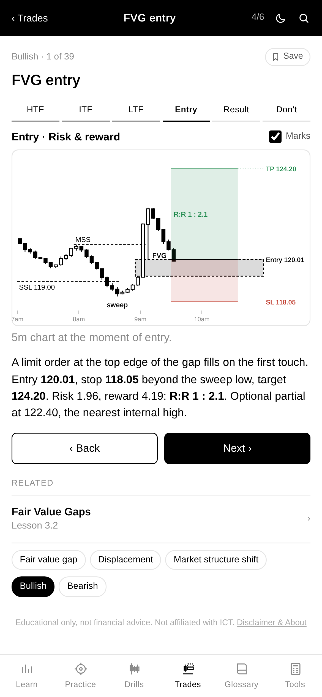
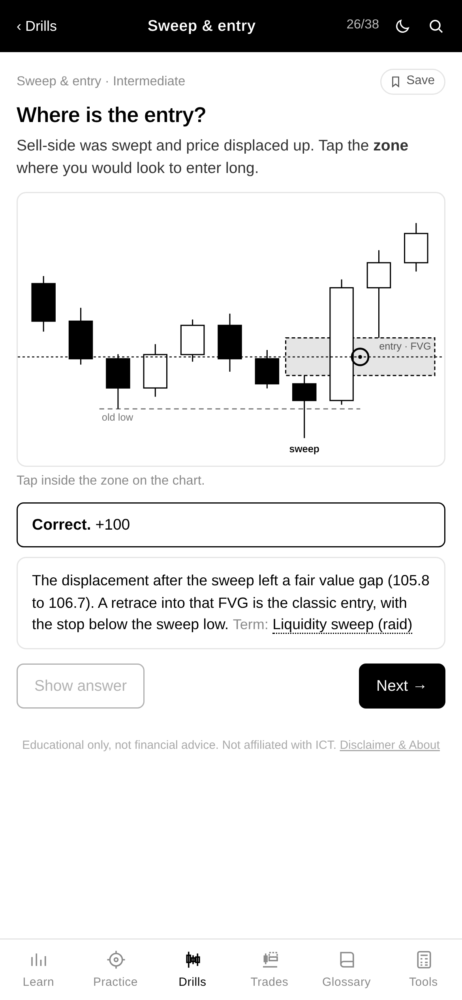
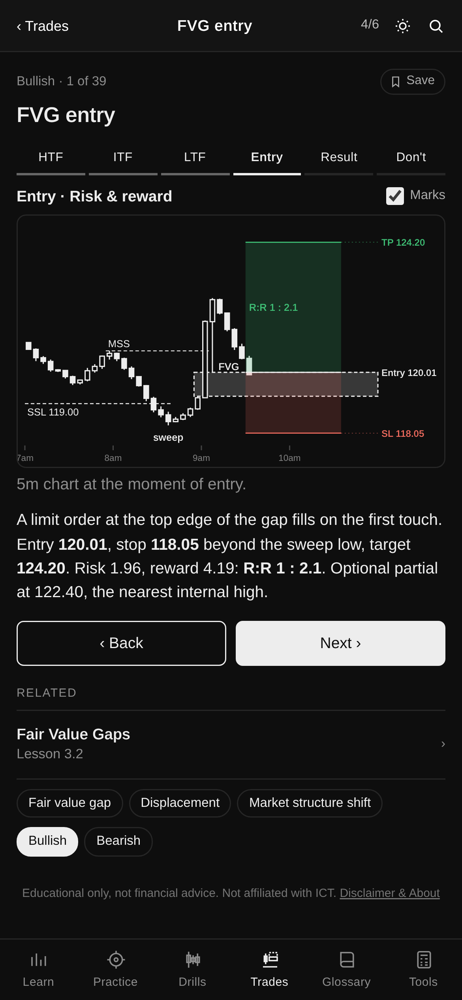

# Chart School

Learn to read charts and trade ICT concepts, from your first candle to a professional-level process.

**Live app: [kavdope.github.io/chart-school](https://kavdope.github.io/chart-school/)**

  
  
  

## What it is

Chart School is a free trading course that runs in your browser and works offline. It starts with what a market is and works up to ICT concepts such as liquidity, fair value gaps, order blocks, killzones and complete entry models. Each lesson has a short quiz. Once you've learned a concept, you can practise it on interactive charts and follow complete example trades from the 4H chart down to the 5m entry.

## Features

- **13 levels, beginner to advanced.** 142 lessons, 448 quiz questions and a 203-term glossary. You need 80% on a lesson's quiz to complete it. A placement test sets your starting level.
- **38 chart drills.** Tap the candle, level or zone on hand-built charts, or pick an answer. Filter by concept and difficulty.
- **39 top-down trade walkthroughs across 19 ICT models.** Each one goes step by step: 4H bias and draw on liquidity, 15m liquidity, 5m sweep and shift, then the entry with a stop and target box and its R:R, the outcome and a checklist. Most models have bullish and bearish versions. Silver Bullet covers all three windows.
- **What not to do.** Every walkthrough also shows the same trade taken wrong (too early, stop too tight, chasing, fading the sweep) and how it got stopped out.
- **Mistake library.** 39 common mistakes in 7 categories, each with a chart, why it happens and the fix.
- **Search and bookmarks.** Search across lessons, glossary, drills, walkthroughs and mistakes, and save anything to come back to.
- **Killzone clock and tools.** A live session and Silver Bullet clock in New York time, a position size calculator, a trading plan builder and spaced-repetition flashcards.
- **Dark and light mode.** Follows your device by default. Switch from the top bar or in Settings.
- **Offline PWA.** Works without a connection after the first visit. On iPhone, open the site in Safari and tap **Share > Add to Home Screen** to install it like an app.

## Curriculum

| Level | Title | Covers | Lessons |
|---:|---|---|---:|
| 0 | Absolute Basics | Markets, orders, leverage, candles, the math of losing | 16 |
| 1 | Foundations of Price | Swings, trends, structure, ranges, S/R, candles, volume | 7 |
| 2 | Liquidity | BSL, SSL, equal highs/lows, ERL/IRL, sweeps, inducement, DOL | 10 |
| 3 | PD Arrays | FVG, BISI/SIBI, IFVG, BPR, order blocks, breakers, gaps, the matrix | 15 |
| 4 | Structure Shifts | BOS vs MSS, displacement, CISD, STH/ITH/LTH, fractals | 8 |
| 5 | Premium & Discount | Dealing range, equilibrium, OTE, Fibonacci, SD projections | 6 |
| 6 | Time & Price | Sessions, killzones, Silver Bullet, macros, AMD, weekly profiles, news | 12 |
| 7 | HTF Bias & Narrative | Top-down analysis, daily bias, DOL, narrative, alignment | 7 |
| 8 | Entry Models & Confirmation | Pre-entry checklist, confirmation, stops, targets, every major ICT model | 17 |
| 9 | Advanced ICT | SMT, IPDA ranges, quarterly theory, intermarket, COT, order flow, MM models | 8 |
| 10 | Risk Management | Position sizing, R, expectancy, drawdown, risk of ruin, limits, prop firm rules | 12 |
| 11 | Trading Psychology | FOMO, revenge, tilt, patience, process, routines, journaling, streaks | 13 |
| 12 | Becoming a Professional | Trading plan, backtesting, forward testing, metrics, taxes, business mindset | 11 |

Walkthrough models: FVG, order block, breaker, mitigation block, IFVG, OTE, Silver Bullet, Judas swing, turtle soup, Power of 3 (AMD), Market Maker Buy/Sell Model, 2022 model, unicorn, BPR, rejection block, propulsion block, liquidity void fill, killzone reversal and SMT.

## Privacy

There are no accounts, ads, analytics or tracking. Your progress, quiz scores, bookmarks, notes and theme choice are stored only in your browser on your device (localStorage). Nothing is sent to a server. Clearing site data, or using Reset in Settings, removes it.

## Tech

Plain HTML, CSS and JavaScript, with no frameworks, dependencies or build step. Every chart is SVG generated in the browser. A service worker caches the app for offline use. The app is a handful of static files, so you can host it anywhere or open `index.html` directly.

## Disclaimer

Chart School is for education only. It is not financial, investment or trading advice, and nothing in it is a recommendation to buy or sell anything. Trading involves substantial risk of loss. Charts and example trades are illustrations, not real market data, and past performance does not indicate future results. Chart School is independent and is not affiliated with, endorsed by or connected to Michael J. Huddleston or The Inner Circle Trader (ICT). ICT terms are used for educational purposes.
